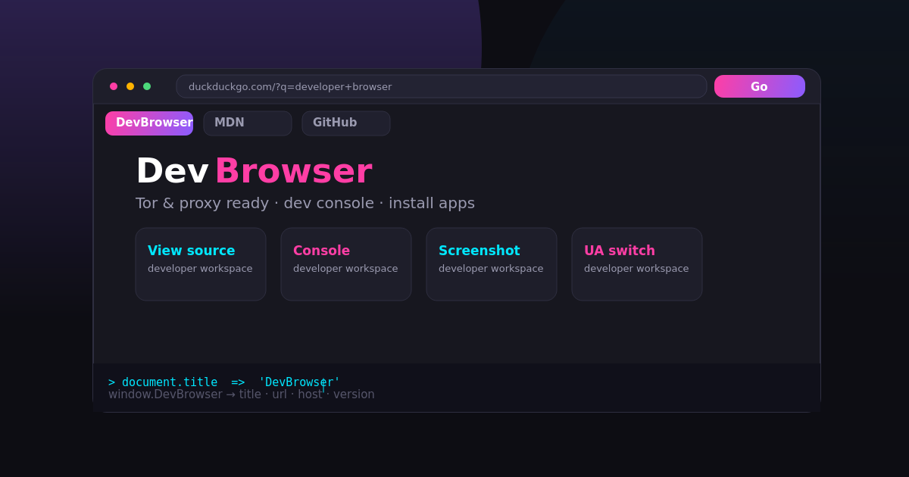

# DevBrowser

An Android web browser built **for developers**, with an Opera GX-inspired neon
theme, Tor/proxy support, an in-app developer console, and one-tap APK
installation.



## Features

- 🎨 Neon dark theme (pink / cyan / purple), Opera GX-style tab strip
- 🌐 Multi-tab browsing + incognito tabs
- 🔎 Smart address bar (URL or search)
- 🧅 **Tor / proxy**: Orbot preset (`127.0.0.1:8118`) **or in-app proxy server
  tunneling through SOCKS5 (Orbot `127.0.0.1:9050`)**; WebView proxy override
  (no androidx dependency — reflected `SupportLibWebViewChromiumFactory`)
- 🛠 **Dev tools**: captured `console.*`, live JS eval, **network log inspector**, **tap-to-inspect DOM**, **HTML/CSS/JS workspace with live preview**, view-source, screenshots, UA switcher
- 🧾 History + bookmarks (SQLite), clickable, deletable
- 📥 Downloads with its own engine and **APK install** flow
- 🌍 English + සිංහල (Sinhala) UI
- 🚫 Zero AndroidX/Room/Gradle required — pure platform API, ~230 KB APK

## Build

```bash
bash tools/setup-toolchain.sh    # offline toolchain bootstrap (JDK, aapt2, d8, apksigner, media)
make apk                         # or: bash tools/build.sh
make info                        # badging + signature info
```

Output: `app/build/apk/DevBrowser-1.0.0.apk` (debug-signed).

Requires a JDK 17, the four offline binaries in `docs/TOOLCHAIN.md`, and
Python 3 for the icon/media generators. A normal Android Studio / Gradle
environment works too — see `docs/BUILDING.md`.

## Docs

- [Architecture](docs/ARCHITECTURE.md)
- [Building](docs/BUILDING.md)
- [Toolchain (offline)](docs/TOOLCHAIN.md)
- [Roadmap (5-month plan)](docs/ROADMAP.md)

## Media / design tools

The `tools/` directory also contains the 3D/2D pipeline used for assets
([demo render](docs/media/torus_knot.png), [animated banner](docs/media/banner.mp4)):

```bash
python3 tools/demo_2d.py     # PySide6 offscreen render → banner.png + banner.mp4
python3 tools/demo_3d.py     # trimesh torus-knot + matplotlib → torus_knot.png/.mp4
python3 tools/make_icons.py  # all launcher PNGs + adaptive foreground
```

## Status

Progress: **v1.1.0** — Phase 1 foundation ✅, Phase 2 (in-app Tor proxy,
ad/tracker blocking, cookie hardening) ~80%, Phase 3 (network log, DOM
inspector, workspace) 60%. See [GRAND_PLAN.md](docs/GRAND_PLAN.md) and
[ROADMAP.md](docs/ROADMAP.md) for the 5-month plan (per-site proxy rules,
CDP network panel, GeckoView engine, F-Droid release).
